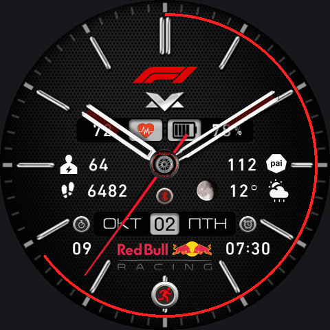
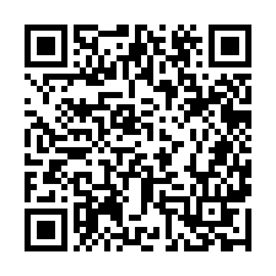

# Max Verstappen Watch Face for Amazfit Balance 2

A Red Bull Racing / Max Verstappen analog watch face for the **Amazfit Balance 2** (Zepp OS, round 480x480 display), with a Russian date and a set of extra fields and tap zones.

  

## Installation

Install via **Zepp Developer Mode** by scanning a QR code. No account or region change is needed; the package is hosted here on GitHub Pages.

  

1. Open the **Zepp** app on your phone (with the Amazfit Balance 2 connected).
2. Enable **Developer Mode** in Zepp.
3. In Developer Mode, **scan the QR code** above.
4. Zepp downloads the package and installs the watch face over Bluetooth. It stays in the Developer Mode watch face list, so you can reinstall it from there; scanning the same QR again downloads the latest version.

**Direct package link:** [`Max_Verstappen.zpk`](Max_Verstappen.zpk)

QR encodes: `watchface://flash797.github.io/max-verstappen-balance2/Max_Verstappen.zpk`

## What it shows

- Analog time, Russian month and weekday, date
- Heart rate and battery
- BioCharge and weekly PAI
- Steps, weather and moon phase
- Next alarm time under the alarm icon
- Running timer: an icon appears while the system timer runs, with the remaining minutes below it (seconds in the last minute)
- Bluetooth disconnect icon, also on the always-on display
- Simplified always-on display without seconds, to save battery

## Tap zones

Workouts, sleep, heart rate, battery, BioCharge, music, PAI, steps, calendar (date), weather, timer and alarm each open their own screen.

## Specifications

| | |
|---|---|
| **Device** | Amazfit Balance 2 (Zepp OS, 480x480 round display) |
| **Package** | `.zpk`, about 320 KB |

## Credits

The **Max Verstappen** watch face design and its Russian version belong to their original authors (a third-party Zepp OS watch face). This repository contains only an adaptation for the Amazfit Balance 2 with additional fields and tap zones. Not for commercial use.
